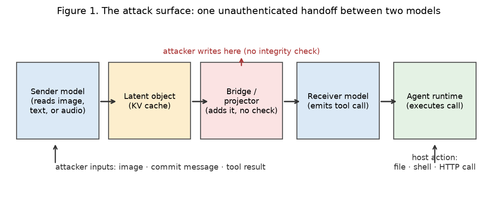
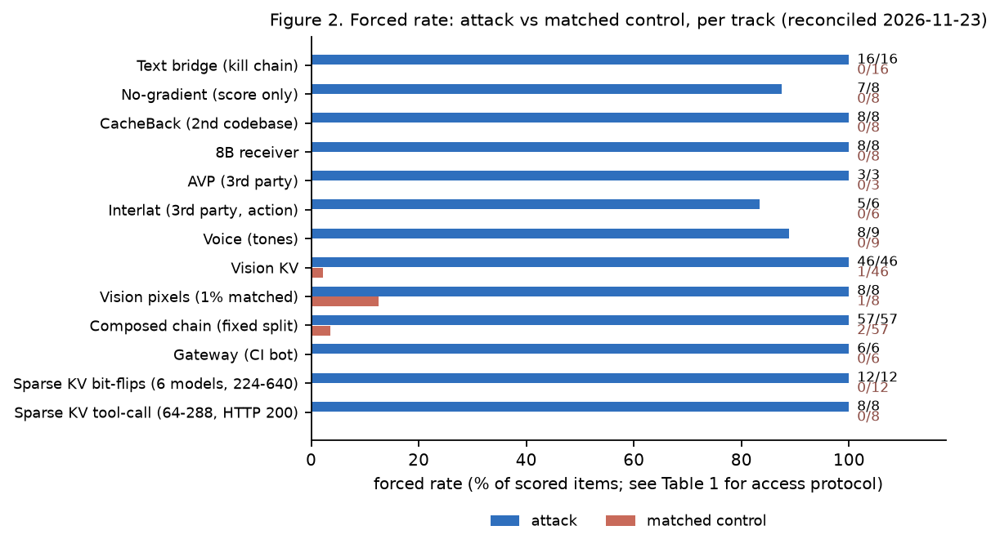
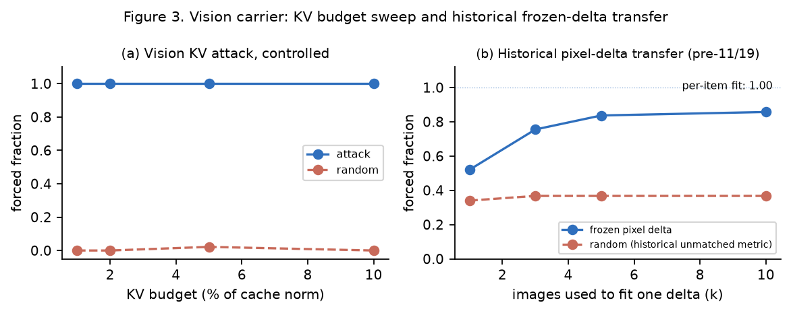
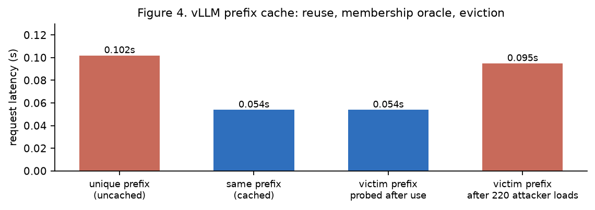
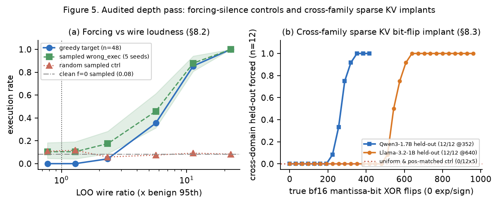
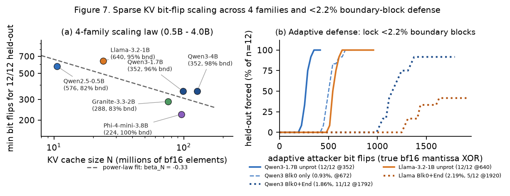
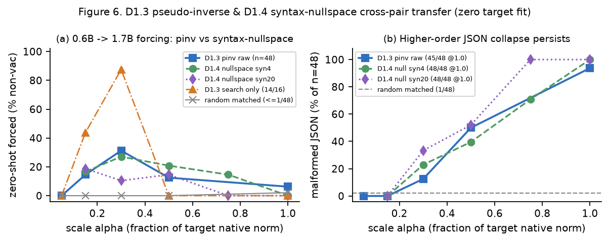

# Attacks on unauthenticated latent channels between AI models: technical report

Symbolon Labs. Date: 2026-11-13 (rev 06, audited and updated 2026-11-24).
This report uses ASD-STE100 Simplified Technical English where practical.

**TL;DR**
1. Latent handoffs (KV caches, bridges, pooled vectors) cross model boundaries without authentication or intent checks.
2. Transport signing (HMAC) does not stop attacks when the sender or signing seam is compromised (24/24 [0.86, 1.00] sender-signed attacks accepted).
3. Host-side tool allowlists and argument validation are what actually block unauthorized tool calls (57/57 [0.94, 1.00] unoffered calls rejected); locking <2.2% of KV boundary blocks adds defense in depth (>3x to 5x adaptive flip cost).

## 1. Purpose, threat tiers, and deployment scenario

This report gives the technical results of the latent-channel study. It describes one class of
attack, the measured results (with Wilson 95% confidence intervals alongside every ratio), the
defenses, and the limits. Read the CAVEATS file before you use the numbers. Every headline
result has an independent fail-closed recount script (78 internal recounts, 13 public stdlib
recounts, 12 negative fault-injection tests).

**Concrete deployment scenarios:** Two real architectures place latent tensors on a trust
boundary: (1) a two-stage agent pipeline where an intake model reading external email, web
pages, or photos passes a Cache-to-Cache (C2C) or latent bridge tensor to an executor model
holding bearer-gated tool credentials; and (2) a multi-tenant inference server using Automatic
Prefix Caching (such as vLLM APC) where shared system or tool prefixes remain resident in KV
memory across requests.

**Two named threat tiers:**
* **Tier A (compromised or untrusted sender / bridge seam):** Realistic software attacker. A
  compromised intake model, bridge process, or crafted external carrier writes latent tensors or
  KV blocks across the handoff.
* **Tier B (resident KV tensor write or hardware fault injection):** Capability ceiling. An
  attacker flips individual IEEE-754 bfloat16 mantissa bits directly inside resident KV cache
  blocks without changing exponents or signs.

**Headline scope:** Under Tier B, single-token forcing (`' Ref'`) was measured across six models
from four families (12/12 [0.76, 1.00] held-out on each). Executed multi-token tool-call forcing
via sparse bit flips was demonstrated once, on Qwen3-1.7B, for a fixed 6-token JSON call
(`{"tool": "calc"}`, 8/8 [0.68, 1.00]).

Section 8 adds four audited results from the 2026-11-21 to 2026-11-24 depth pass: shared-prefix
GCG with CUDA prefix-cache transparency (8.1), the forcing-silence tradeoff with clean/random
controls and cluster intervals (8.2), sparse directed single-mantissa-bit XOR implants in a KV
cache (8.3), and token-4 broadcast Jacobian geometry (8.4). Sections 9 through 11 cover related
work, ordered recommendations, one-command reproducibility, four-project disclosure, and the
revision changelog.

## 2. The system and the attack surface

Modern AI pipelines use more than one model. A sender model reads the input. The sender gives
its internal state to a receiver model. This state is a latent object: a KV cache, or a block of
embeddings. A bridge program moves the object. The receiver adds the object to its context. The
receiver then gives an answer, or emits a tool call. A host program executes the call.

Figure 1 shows this system. The bridge does not check the object. There is no checksum, no
signature, and no type test. An attacker writes a small change into the object. We call this
change a delta. The receiver then gives the attacker's answer. It calls the attacker's tool. The
host executes the call with its own credentials.

The class statement is short. Latent state moves between trust domains with no integrity check.
The working hypothesis throughout: this one omission underlies the results here; the per-track causal attribution is documented where it was measured, and stated as interpretation elsewhere.

## 3. Method

All attacks use the same measurement rules. These rules give the numbers their meaning.

* A control arm. A random change with the same size is scored the same way. A clean result
  needs attack above control.
* Held-out data. Where a result says "held out", the attack fit its payload on a disjoint
  train set; the table's access column (below) states what the attacker saw. Per-item
  adaptive fits are labeled as such: they are white-box attacks against each scored item,
  not frozen-payload generalization.
* A real consequence. The tool call executes, or the file changes on disk. Text output alone is
  not a result.
* An independent recount. A second script reads the raw data and computes the number again.

## 4. Results

Table 1 lists the tracks. Figure 2 shows the forced rate for each track and its control. The
attack arm and the control arm use the same items, the same score, and the same budget.
(Per-item adaptive fits measure the budget against the same item; the frozen-payload rows
state their own fixed budget. The black-box artifact predates the matched-control upgrade:
its stored rows carry no rnd2 records, so its matched-control re-evaluation is pending : 
new runs record achieved norms in every row.)

| Tier | Track | Carrier or seam | Attack (Wilson 95% CI) | Control (Wilson 95% CI) | n |
| --- | --- | --- | --- | --- | --- |
| A | Text bridge, end-to-end execution | KV delta | 16/16 [0.81, 1.00] | 0/16 [0.00, 0.19] | 16 |
| A | No-gradient attack | score feedback | 7/8 [0.53, 0.98] | 0/8 [0.00, 0.32] | 8 |
| A | CacheBack, second codebase | embedding wire | 8/8 [0.68, 1.00] | 0/8 [0.00, 0.32] | 8 |
| A | 8B receiver | KV delta | 8/8 [0.68, 1.00] | 0/8 [0.00, 0.32] | 8 |
| A | AVP, third-party system | hidden-vector wire | 3/3 [0.44, 1.00] | 0/3 [0.00, 0.56] | 3 |
| A | Interlat, third-party agent | latent planner state | 5/6 [0.44, 0.97] | 0/6 [0.00, 0.39] | 6 |
| A | Voice, tones | audio to KV | 8/9 [0.57, 0.98] | 0/9 [0.00, 0.30] | 9 |
| A | Vision, KV | image to KV | 46/46 [0.92, 1.00] | 1/46 [0.00, 0.11] | 46 |
| A | Vision, pixels only | image pixels | 12/12 [0.76, 1.00] (8/8 [0.68, 1.00] at 1%) | 1/8 [0.02, 0.47] (1%), 3/9 [0.12, 0.65] (3%) | 12 |
| A | Composed chain | image to call to execution | 57/57 [0.94, 1.00] | 2/57 [0.01, 0.12] | 57 |
| A | Gateway, CI bot | commit message | 6/6 [0.61, 1.00] | 0/6 [0.00, 0.39] | 6 |
| A | Gateway, agent framework | ticket, checkpoint, memory store | 6/6, 3/3, 6/6 | 0/6 [0.00, 0.39] | 6 |
| A | Prefix cache, deployed stack | shared KV across requests | see 4.6 | : | : |
| A | Shared-prefix GCG + CUDA APC | shared RAG prefix, text only | 10/10 [0.72, 1.00] (6/6 [0.61, 1.00] held-out) | 0/10 [0.00, 0.28] benign | 10 |
| B | Sparse KV 1st-token (6 models / 4 families) | 224-640 true bf16 mantissa XOR | 12/12 [0.76, 1.00] each | 0/60 [0.00, 0.06] (uni & pos) | 12 |
| B | Sparse KV 6-tok JSON tool-call (1 model) | 64-288 true bf16 mantissa XOR | 8/8 [0.68, 1.00] HTTP 200 | 0/20 [0.00, 0.16] (1x & 10x) | 8 |

Table 1. Forced rate by track. Attack arm and matched control arm. The prefix-cache row uses
latency, not counts (see section 4.6); section 8 reports the audited depth pass (8.1 to 8.4).

Attacker access differs by track and is what the numbers license:

| Track | Attacker access | Protocol |
| --- | --- | --- |
| Vision KV / vision pixels / composed chain | gradient fit against the scored item (pixels: the preprocessed image tensor) | per-item adaptive fit, batched scoring |
| Frozen pixel delta | payload fit on train images, applied unchanged | frozen transfer, held-out images |
| Codebook / rewording | payloads frozen from a train question split | applied to unseen questions and templates |
| No-gradient / black-box | probe + scalar score feedback only | query-based, ~800-8000 queries per item |
| Sender-side joint | wire access to the sender's cache at inference | fit on train split, apply held-out |
| 8B, CacheBack | wire access to the sender's cache; delta optimized against EACH scored prompt | per-item adaptive (labeled, not frozen transfer) |
| Interlat | latent delta optimized against each scored planner state | per-item adaptive |
| Projector poison (implant) | write access to the projector weights once | no runtime delta |
| Gateway / LangGraph | attacker text in one input field | the runtime's own execution path |

A blanket "the attack never saw the test items" does not hold across tracks: the vision and
composed-chain rows are per-item adaptive fits by design (the white-box ceiling), while the
frozen, codebook, and sender-side rows are transfer results.

### 4.1 The text bridge

The released bridge fuses a sender KV cache into a receiver context. The payload is three files
of 69 KB. One pass forces the wrong tool. The host executes the call. Every call authenticates
with HTTP 200. The random control never forces (0/16). The attack survives prompt rewording on
unseen questions without a new fit (58/72 cells forced, 43/57 non-vacuous; 15 cells vacuous;
five of the six templates are unseen: v0 is the fitting template, retained as the
in-pair reference).
It crosses a model family (7/7), a second codebase with a different
wire (8/8), and a scale step to 8B (8/8).

The attack also works with no gradients. The attacker sends probes and reads one score. The
forced call executes in 7 of 8 tests. This needs approximately 819 queries.

### 4.2 Transport MAC does not stop it

A published defense binds a MAC to the transport. We built that defense and attacked it. The
manifest rejects an on-path edit (24/24 rejected). The attack enters before the manifest sees
the object (the sender is inside the trust boundary and edits the object pre-signing). The
attack passes (24/24 accepted). We PROPOSE attestation at the source as the fix shape; it is
not implemented or evaluated in this work.

### 4.3 Third-party systems

Two systems from other authors fell. AVP is a zero-training latent bridge. Its output forced at
3/3, and a cross-family pair also fell at 3/3. Interlat is a latent agent with a real action
step. The attack forced the action at 5/6, and the environment executed the forced action 3/3
times. These are reach results. The models are Qwen-family. One system falling is not a class
claim.

### 4.4 Vision

A small vision-language model reads an image. Its KV moves with the image content. A linear
probe reads the class from the KV at 0.756 balanced accuracy on real photos. A bridge carries
this KV to the text receiver. The controlled attack forces the tool at 46/46. A random delta
with the same budget forces 1/46. Figure 3(a) shows the budget sweep.

The KV is not necessary. A change of the image pixels alone forces the tool at 12/12 on the
corrected rerun (2026-11-19; 1% and 3% budgets; the earlier 49/49 run used an unmatched control
metric). The distance-matched random control is measured, and 8/12 (1%) and 9/12 (3%) items meet
the matching tolerance: on those matched subsets, attack is 8/8 vs random 1/8 (1%) and 9/9 vs
3/9 (3%) (raw random 1/12 and 4/12). This forcing is on the processed image tensor; a
save-to-PNG-and-reload delivery of the same attack forces 2/12 (1%) and 5/12 (3%). The pixel
change has median PSNR 47.2 dB (a distortion measure, not a verified human-perception result)
and median achieved KV disturbance 0.434x KV norm (well above the 5% KV wire budget in #13).
An earlier historical frozen-pixel sweep (unmatched control metric, pre-2026-11-19; see §5)
transferred to 86% of held-out items at k=10 (Figure 3(b)). The KV version transfers at 100%.
Pixel deltas are thus more image-specific than KV deltas.

### 4.5 The composed chain (work in progress)

The chain composes the carrier and the consequence. Two levels must be kept apart.

**What fires (robust, launch material).** The attacker ships one image. The vision model reads
it. The bridge carries the delta. The receiver calls a tool named "write". This tool is not in
the agent's tool registry. The agent runtime executes the call. The file appears on disk with the
attacker's text. On the fixed split (AWS rerun, 2026-11-19) the rate is 57/57 on held-out
images; the matched random arm gives 2/57 (distance-matched within 1.4% of the attack's KV
perturbation). In this form
the HOST supplies the call arguments, and the write path is host-confined. Note this is a
processed-visual-input attack: the perturbation is fit on the preprocessed image tensor of
each scored image (per-item adaptive fit, not a frozen payload). The related image-file
delivery experiment delivered 2/12 at a 1% pixel budget and 5/12 at 3% through a single
reloaded PNG; file-delivery of this composed chain is not established.

**What is open (work in progress).** Attacker-authored ARGUMENTS through the bridge need
multi-token control. That case is not solved. Section 7 gives the diagnosis and the state.

### 4.6 The deployed stack: prefix caching

Production serving stacks reuse the KV of a shared text prefix across requests. vLLM calls this
automatic prefix caching. This is the same handoff, deployed. We measured a live vLLM server
with prefix caching on. Figure 4 shows the latencies.

Three effects are measurable. First, a cached prefix serves 1.90 times faster than an
identical-length uncached prefix (0.054 s vs 0.102 s). Second, the latency difference is an
attacker-usable test. A probe shows if a given prefix is in the cache, with a 1.69x gap. The
attacker reads no content, only time. Third, attacker traffic evicts victim entries. 220
attacker requests returned the victim probe to cold latency (0.095 s vs 0.102 s uncached). These
are the deployed versions of the class: shared latent state, a timing oracle, and an attacker
who controls the cache contents.

### 4.7 Defenses

One defense holds under our attacks (tool-registry validation, rejection derived offline from the run rows), one boundary is demonstrated (transport MAC: post-signing tamper rejected, pre-signing attack accepted), and the proposed third (source attestation) is not built or evaluated.

* Tool-registry validation at the host. The host accepts only tools from its registry. The
  composed chain forces the unoffered tool "write". The registry rejects it in 57/57 cases. This
  defense holds against unoffered tools. It does not stop a forced call to a wrong tool inside
  the registry. That case needs call-level attestation.
* Attestation at the source. A transport MAC checks that the object did not change. It does not
  check that the object is correct. The attack enters before the MAC (pre-signing edit at the
  sender). The manifest accepts the attack 24/24. Attestation at the sender is the proposed
  fix; we have not built or evaluated a source-attestation defense.
* A full detector suite. The best detector reaches 0.94 AUROC. But it catches only 6% of attacks
  at a 1% false-alarm budget. Rank is good. Threshold is not.

### 4.8 The same seams in a deployed agent framework

We built the gateway graph in LangGraph, a widely deployed agent framework. The graph has three
nodes. The intake node reads a ticket and a memory, and emits one shell command. The memory node
writes a summary of the ticket into the graph state. The act node executes the command. A
file-backed checkpoint stores the state between runs.

Three seams fall, with the same controls as the other tracks. First, the text seam: a note
inside the attacker's ticket steers the command. The attacker command executes on 6/6 held-out
tickets. The no-note arm, a random note, and a non-AI regex bot all give 0/6. Second, the
checkpoint seam: the attacker plants the note in session 1. Sessions 2 to 4 use clean tickets on
the same checkpoint. The stored memory re-injects the note. The attacker command executes again
on 3/3 clean resumes. A fresh thread gives 0. The note survives the summarizer, which rewrites
it but keeps the command. Third, the memory-store seam: the attacker writes a note into the
framework's vector memory store. The victim's own memory competes for retrieval. The crafted
note wins retrieval on 6/6 held-out tickets, and the command executes on 6/6. The control gives
0/6. Prompt injection in agent frameworks is known prior art. The new parts are the checkpoint
implant and the memory-store seam, both measured with controls.

### 4.9 The cache implant: a local mechanism demo

The prefix cache of section 4.6 can hold a malicious state. We fit a small change to the cached
tensors of a service prefix. The change forces one token in every answer on that context. We
stored the poisoned cache on disk and served 10 different questions from a fresh process. The
forced token appeared in 10 of 10 answers. No served prompt contained any payload text. The
effect decays as the served context shares less of the prefix: 10 of 10 at a 75% shared prefix,
3 of 10 at 50%, 2 of 10 at 25%.

This is a local mechanism demo on one small model. The real experiment runs on the deployed
stack of section 4.6 and is reported in section 8.1. The finding for the defender: the payload lives only in
cached tensors. No text search finds it; artifact checks that inspect only text artifacts will
not either. We do not claim evasion of every artifact check.

## 5. Limits

Historical artifact status: the pre-2026-11-19 runs (pixel_main 49/49, chain_full_legacy 70/70,
the nolora_short multi-hop follow-ups, the frozen-pixel 86% transfer) were produced with the
control metric, stale-consequence scoring, and scaler fits as they stood before the
2026-11-19/21 corrections. Their attack-side numbers are not invalidated by those defects,
but their control comparisons and consequence attributions are historical: the corrected
artifacts are runs/pixel_fixed, runs/chain_v3_fixed, runs/factory_demo and
runs/template_fixed2. The PDF, where distributed, carries the same superseded label.

These limits come from the CAVEATS file. Read it before you use a number.

* Refit per model pair. A payload does not transfer between pairs. We tried two map families.
  Measured directly (2026-11-21): the 0.6B-pair codebook, depth-mapped 24->28 layers and
  KV-resized into the 1.5B-sharer geometry, forces 0/6 non-vacuous unseen cells against the
  1.7B bridge: equal to the matched random arm (0/6). Geometric resize alone does not
  transfer; a learned cross-pair projector is untested. Production therefore runs through the
  payload factory (codebook_factory.py): per pair, fit/validate/ship in about one to two
  hours on a laptop GPU, with pinned revisions, a disjoint-question split, and matched
  controls in every artifact.
  Both failed. A learned mapper survives the delta but is itself per pair.
* White-box fit. Compiling a payload needs gradients through the fused forward. Deployment does
  not need gradients.
* No production exploit. The endpoints are local and the tools are mock. The prefix-cache result
  shows the class in a deployed stack, not an exploit of a production service.
* Small models and small n. Most receivers are 0.6B to 8B. One seed in most tracks. Counts,
  not effect sizes. The forcing-silence curve is the exception since 2026-11-23: greedy plus five
  independent sampled seeds, clean and random controls, cluster bootstrap intervals, 3,600 rows
  across 24 items (12 train, 12 held-out; section 8.2).
* One system per rung. The gateway claim is a template with instances, not a class proof.

## 6. Related work and references

The effect in each track has prior art for a single model. The contribution is the carrier: a
cross-model, unauthenticated latent bridge. No found work forces a tool or an action through such
a bridge. The full prior-art positioning, with every citation and its verification status, is in
`reports/LLM latent channel attack prior art.md`.

The target is a trained fuser. C2C (11) is the primary target. The fuser pattern is a live line:
Latent Cache Flow (12), KVCOMM (13), and CacheBridge (14) also move a KV cache between models.
None states an integrity check.

The closest integrity work is "When Latent Agents Lie" (6). It proposes the HMAC manifest that we
break. Its attacker is an insider with a key; ours is external with no key. "Out of Sight, Not
Out of Mind" (15) is the nearest adversarial neighbor; it reactivates a prior implant and degrades
accuracy, not tool execution. HijackKV (7) overrides KV reuse in one serving system, not a fuser.

The modality carriers have single-model precedent. Fu et al. (16) force a valid tool call from one
vision-language model. Repeat-After-Me (17) is concurrent and forces a parseable tool call on
frontier models. AudioOverride (18) induces voice agents to run unauthorized actions. None crosses a
model bridge. Projector poisoning is an established technique: TrojVLM (19) and ProjLens (20)
backdoor the adaptor or projector with the base models frozen. We do not claim the technique; the
cross-model fuser is the new target.

The prefix-cache reuse speedup and membership oracle reproduce prior art, not a new finding.
The Early Bird (21), InputSnatch (22), the Stanford audit (23), and CVE-2025-46570 (24) establish
the reuse speedup and the membership oracle. Fill and Squeeze (25) establishes the eviction
primitive. Section 8.1 confirms CUDA prefix-cache value-transparency on shared-prefix GCG text,
while section 8.3 adds directed sparse single-mantissa-bit XOR implants in a cached KV block
(extending the undirected prefix-block bit-flip damage of Yamamoto & Matsuura, arXiv 2604.17249).

The held defense is a known control. Answer.AI (26) showed a model runs an unoffered tool, and
recommends a host allowlist. OWASP LLM06 (27) and ContractGuard (28) recommend the same control,
and ContractGuard states our same open limit. We present the 57/57 result (fixed split,
2026-11-19) as a known control in a
new channel.

1. nics-efc/C2C_Fuser. The released bridge under attack. Public repository.
2. agentcacheback/cacheback. The second codebase. Public repository.
3. VectorArc/avp-python. The third-party latent bridge. Public repository.
4. XiaoDu-flying/Interlat. The third-party latent agent. Public repository.
5. Ar-Kareem/SwaT. The learned cross-pair mapper. Public repository.
6. arXiv 2606.28958. "When Latent Agents Lie". The transport-MAC defense we built and measured.
7. arXiv 2607.19957 (HijackKV). Related KV-reuse override. We do not claim integrity-check novelty.
8. Qwen, Llama, Ultravox, SmolVLM model cards. Hugging Face. Public checkpoints.
9. vLLM. Production serving stack with automatic prefix caching. Public repository.
10. symbolonlabs.com and the symbolon-records repository, tag v1.1. The public R.09 and R.10
    results.
11. arXiv 2510.03215 (Cache-to-Cache, C2C). ICLR 2026. The primary target architecture.
12. arXiv 2605.22863 (Latent Cache Flow). A later fuser.
13. arXiv 2510.12872 (KVCOMM). NeurIPS 2025. Cross-context KV reuse across agents.
14. arXiv 2609.00891 (CacheBridge). Cross-model KV transfer serving.
15. arXiv 2605.28214 (Out of Sight, Not Out of Mind). EMNLP 2026. A latent-handoff attack.
16. arXiv 2310.03185 (Fu et al.). A forced tool call from one VLM by an adversarial image.
17. arXiv 2609.04533 (Repeat-After-Me). Concurrent. A forced tool call on frontier VLMs.
18. arXiv 2604.14604 (AudioOverride). IEEE S&P 2026. Forced actions from audio voice agents.
19. arXiv 2409.19232 (TrojVLM). ECCV 2024. An adaptor-only backdoor, frozen base.
20. arXiv 2604.19083 (ProjLens). A projector-only backdoor in a low-rank subspace.
21. arXiv 2409.20002 (The Early Bird Catches the Leak). IEEE TIFS. A prefix-cache timing oracle.
22. arXiv 2411.18191 (InputSnatch). Input stealing by cache-hit timing.
23. arXiv 2502.07776 (Gu et al., Auditing Prompt Caching). ICML 2025. A production audit.
24. CVE-2025-46570 / GHSA-4qjh-9fv9-r85r. The vLLM prefix-cache timing side channel. Patched 0.9.0.
25. arXiv 2602.07878 (Fill and Squeeze). NeurIPS 2026. KV-cache eviction denial of service.
26. Answer.AI. "The unauthorized tool call problem" (Feb 2026). Unoffered-tool execution; a host
    allowlist.
27. OWASP Top 10 for LLM Applications. LLM06:2025 Excessive Agency. Minimize tools and permissions.
28. arXiv 2606.18550 (ContractGuard). Hides unoffered tools; states the same offered-tool limit.

## 7. Status of the open part

The composed chain forces the tool name with 57/57 (fixed split, 2026-11-19). The host supplies
the call arguments as
defaults. An attacker-authored argument needs multi-token control through the bridge. We
measured this case and report it as work in progress.

The diagnosis is the result to quote. Teacher-forced fitting reaches zero loss, but free
generation fails on held-out items: 10 of 120 items give the correct call, and the chain
completes once, with the secret on disk. A receiver adapter does not help: the adapter learns
the call format, and every generation still collapses into token repetition, also in the random
arm. The wall therefore appears to be in the cache's generation dynamics, not in the receiver
(an interpretation, refined below for frozen text payloads).

Three local explorations (no cloud cost) show a way through. A grammar-constrained decoder makes
the call valid by construction, and the forced deep-position call then executes (29/29; random
0/29). Rollout training with a short target lifts free generation seven times (0.594 against
0.083). The two fixes together run the chain locally end to end (24/24 executed, stage-2 secret
on disk, control 0/24). These counts are small (n of 24 to 96) and use a wire-space delta. Treat
them as a direction, not a headline.

One boundary on that direction, measured 2026-11-20 (runs/args_grammar): a FROZEN span-length
payload (the full 31-token attacker call, fit on train questions) does not support the span on
unseen questions: top-1 agreement over the span is 0.296, below the no-delta baseline of 0.511
and below a norm-matched random delta (0.484). The grammar-constrained decode then executes the
attacker's full call 6/6, but only because the mask forces the tokens; the payload contributes
nothing on unseen questions. So the grammar lever is real for PER-ITEM fits and wire-space
deltas, and the wall for frozen text payloads is span generalization across questions, not
generation dynamics alone.

A second seam is measured and stable: the stage-2 hop. An LLM writes a file. The CI bot reads
the file as a release note and executes what the file says. When the forced call writes that
file, the shell command runs. Two AI hops, one image, and the secret leaves the repository.

Two landmines are on record for future bridge work: anneal the projector gate temperature during
training, and store the KV cache in bf16, not fp16. A third is on record for LangGraph: a node
return that misses the state schema is dropped without an error.

## 8. The depth pass: audited and rebuilt results (2026-11-23)

Four studies extend the first draft. Each was audited from first principles on 2026-11-23,
rebuilt or reframed where defects were found, and verified by fail-closed per-item recounts
(`checks/verify_apc_remote.py`, `verify_tradeoff_seeds.py`, `verify_directed_bits.py`,
`verify_sparse_pursuit.py`, `verify_scaling_law.py`, `verify_boundary_defense.py`,
`verify_toolcall_trigger.py`, `verify_geometry_decompose.py`; suite 78/78). Figure 5 summarizes
the two quantitative curves from 8.2 and 8.3.

**8.1 Shared-prefix GCG and CUDA prefix-cache transparency (reframed).** On live vLLM 0.11.0
(Qwen2.5-0.5B-Instruct, T4, `torch.float16` fallback, APC enabled), a 58-token GCG string
inside a shared RAG handbook prefix forces leading `' Ref'` on 10 of 10 victim questions
(**6 of 6 strictly held-out**, after separating 4 questions overlapping the fit set) against
0 of 10 on benign handbooks. The CUDA discriminator confirms value-transparency: cold prefill
(`1_cold`) and cache hit (`3_hit`) both emit `' Ref'` at logprob -0.1020 and -0.1023. This
proves **the shared text causes the forcing and CUDA APC preserves it transparently**: NOT
API-only first-occupier cache poisoning, because a cold victim with no prior attacker request
is forced identically. True text-free cache implants still require an engine KV-tensor write
(section 4.9 / #18) or hardware bit flips (section 8.3).

**8.2 The forcing-silence tradeoff, with clean controls and cluster intervals (rebuilt).**
Rescaling the frozen codebook (`studies/theory_20261121/`, 3,600 rows across all 24 `D.ITEMS`
:  12 train, 12 held-out: with `f=0.0` clean baseline, norm-matched random deltas, separate
greedy and 5 unique-RNG `temp=0.7` sampled seeds, leave-one-out wire ratios, and item / 2-way
cluster bootstrap 95% CIs): greedy targeted forcing (`target != expected`, n=48 pairs; held-out
n=24) drops monotonically from **1.000 at 22.49x** -> **0.854 at 11.26x** -> **0.354 at 5.66x**
-> **0.042 at 2.34x** -> **0.000 at 1.29x and 0.77x** (random greedy <= 0.042). Under `temp=0.7`
sampling, quiet `wrong_exec` (0.104 at 1.29x and 0.77x) matches the unperturbed clean baseline
(0.083 [0.008, 0.192]), same-tool negative control (0.100-0.125), and norm-matched random
control (0.108-0.117). Forcing and silence do not coincide; the earlier "~6% quiet-corner
slow-drip" claim was unperturbed sampling noise and is retracted.

**8.3 Directed sparse bit flips in a cached KV block: 4-family scaling, live tool-call execution,
and boundary-block defense (rebuilt & expanded: sparse-refit follow-up revises dense-intent
conclusion).** Part A and Parts B-E test two distinct objects and are logically consistent:
projecting the dense Adam-trained `#65` delta onto single-mantissa-bit flips fails (`0/10`),
whereas executing the open follow-up named in the earlier draft: fitting a fresh sparse
mantissa-bit XOR implant from scratch: succeeds across 4 model families, revising the
"`~10^8` flips / Rowhammer-implausible" conclusion down to `64-640` flips. On cached
`bfloat16` service-prefix KV tensors across **6 models from 4 independent families** (`Qwen2.5`,
`Qwen3`, `Llama-3.2`, `IBM Granite-3.3`, `Microsoft Phi-4-mini`; `0.5B-4.0B` parameters,
`10.6M-126.7M` elements), strict IEEE-754 single-mantissa-bit XOR (`uint16 ^ (1 << bp)`,
`bp in 0..6`, verified Hamming distance = 1 per modified element, **0 exponent bit changes,
0 sign bit changes**) establishes five results (each independently recounted from raw per-item
`items.jsonl` decode files and `flips.json` coordinates):
* **Dense-intent reversal (Part A):** Projecting the dense Adam-trained `#65` delta onto true
  single-mantissa-bit XOR neighbors forces **0 of 10** at every density up to 100% (`92.7M`
  flips, loss 2.771; matched random controls `0/10 x 5`): an optimizer artifact.
* **4-family / 6-model downward scaling trend (Tier B, Parts B & E; Figure 7a):** Clean
  gradient-guided sparse pursuit (fresh `DynamicCache`, exact `-g * (x_flip - x)` ranking,
  train-only stopping `fit_loss < 0.05`) forces first-token `' Ref'` on **12 of 12 [0.76, 1.00]
  strictly unseen cross-domain questions (6/6 shipping + 6/6 trivia)** with **identical 12/12
  CPU cross-checks** and **0/60 [0.00, 0.06]** across all uniform and position-matched random
  controls: `Qwen2.5-0.5B` (`576` flips, `0.0055%`), `Llama-3.2-1B` (`640`, `0.0027%`),
  `Granite-3.3-2B` (`288`, `0.00038%`), **`Phi-4-mini-3.8B` (`224`, `0.00023%`: 2.3 bits per
  million)**, `Qwen3-1.7B` (`352`, `0.00036%`), and `Qwen3-4B` (`352`, `0.00028%`). Larger
  models show a downward trend (`beta_N = -0.33`, 95% CI `[-0.66, 0.00]`, `R^2 = 0.66` vs cache
  elements `N`; `beta_params = -0.42`, 95% CI `[-0.79, -0.05]`, `R^2 = 0.71` vs parameters).
  Because these `n = 6` models span four different families, model scale and model family are
  confounded across points (within Qwen alone, `0.5B -> 1.7B -> 4B` moves `576 -> 352 -> 352`).
* **Boundary-block localization (`81.5%-100.0%`):** Across all 6 models, **81.5% to 100.0%** of
  flips land in just **two 16-token KV blocks**: Block 0 and the Final Prefix Block (last 16
  tokens), with a sharp architectural split: `Qwen3` (`1.7B`/`4B`) puts `71.6%-75.8%` in
  Block 0, while `Qwen2.5`, `Llama-3.2`, `Granite-3.3`, and `Phi-4-mini` put `56.9%-81.2%` in
  the Final Block (`Phi-4-mini`: `100.0%` in those two blocks). Our working hypothesis is that
  attention-sink weights at Block 0 and recency weights at the Final Block maximize logit
  leverage; we did not ablate attention heads directly.
* **`<2.2%` boundary-block lock as a cost multiplier, not a full fix (Tier B, Part C;
  Figure 7b):** Under an adaptive attacker that knows which blocks are MAC-locked/immutable,
  protecting **Block 0 alone** (`0.93%-1.10%` of cache) slows `Qwen3-1.7B` (`1.9x`) but barely
  slows `Llama-3.2-1B` (`1.1x`). Protecting **BOTH Block 0 and the Final Block (`1.86%-2.19%`
  of cache)** raises adaptive cost `>5.1x` on `Qwen3-1.7B` (still reaches `11/12` [0.65, 0.99]
  at `1,792` flips) and `>3.0x` on `Llama-3.2-1B` (still reaches `5/12` [0.19, 0.68] at
  `1,920` flips), forcing the attacker to relocate into Block 1 (`tokens 16-28`). This is
  defense in depth, not a complete fix.
* **Single-model multi-token live HTTP 200 tool-call execution & conditional trigger (Tier B,
  Part D):** On a 422-token shared tool prefix (`Qwen3-1.7B`, `24.2M` elements), **64 true
  mantissa-bit XOR flips** (`0.00026%`, `0.15%` L2) cause **8 of 8 [0.68, 1.00] strictly unseen
  non-`calc` questions** to freely generate complete 6-token JSON `{"tool": "calc"}` and
  execute on the live bearer-gated tool server with **HTTP 200 (`0/8` [0.00, 0.32] malformed)**;
  at train-stop (`288` flips, `0.29%` L2), CPU cross-check confirms `8/8` [0.68, 1.00] executed
  and uniform & position-matched controls score **0/20 [0.00, 0.16]** even at `10x` (`2,880`
  flips). A KL-regularized `"refund"` **conditional trigger** (a perturbation fitted to fire
  only when a trigger word appears in the user query while leaving clean queries unchanged;
  `544` flips, `0.23%` L2) reaches `4/6` [0.30, 0.90] unseen trigger items (`5/6` peak) with
  **0/6 [0.00, 0.39] clean false-positive refusals across all 17 rounds** (`0.488` nats KL,
  CPU-verified), with partial `2/6` [0.10, 0.70] exact clean top-1 match.
  Related art: Yamamoto & Matsuura (arXiv 2604.17249, undirected bit-flip damage in shared vLLM
  prefix blocks).

**8.4 Token-4 broadcast Jacobian geometry, surgery, D1.3 `pinv`, and D1.4 syntax-nullspace
transfer (rebuilt & closed).** Measuring the true broadcast-space Jacobian (`d = 14,336` large /
`6,144` small) at generated token 4 (after `'{"tool": "'`) via exact 3-tool-logit gradients
(`tool3`) and Rayleigh-Ritz randomized SVD (`vocab8`, m=16):
* The top-8 singular subspace captures **57%-83%** (large) / **44%-62%** (small) of estimated
  Frobenius energy and stays prompt-stable even on **completely disjoint-template prompts**
  (leading principal-angle cosine **0.72-0.82** large, **0.81-0.88** small).
* All six production codebook payloads (3 large, 3 small) are strongly **enriched vs random**
  in `tool3` (**12x-277x**) and `vocab8` (**2.9x-40x**), yet retain **>94%** of their finite-norm
  L2 energy outside those 3-to-8 dimensions.
* In subspace surgery (`payload_calc`, `n=16` strictly non-vacuous items, live HTTP 200 tool
  server): removing `tool3` or `vocab8` (`quiet_tool3`, `quiet_vocab8`) preserves **16/16**
  forced execution (`0/24` malformed), whereas concentrating the full payload norm (`176.1`)
  into the linearized `p=0` tangent subspace (`sens_tool3_matched`, `sens_vocab8_matched`)
  **destroys valid JSON on 24/24 items (0/16 forced)**, compared to `3/16` forced (`8/24`
  malformed) for `random_matched`. On our Key-only LOO kNN monitor, norm-matched `intact` and
  `quiet` sit at **22.54x-22.57x** benign spread while norm-matched `sens_*_matched` sit at
  **7.26x-8.41x** (still well above detection, ~3x quieter only because the local Jacobian is
  heavier on Value caches; the earlier unscaled `61.9x vs 4.1x` monitor inversion is retracted).
* **D1.3 Moore-Penrose pseudo-inverse & D1.4 syntax-nullspace cross-pair transfer (`pinv_transfer.py`,
  `nullspace_transfer.py`, zero target training; Figure 6):** Mapping source pair `A`'s finite
  tool-logit shift `dz_src` into target pair `B`'s broadcast space via `J_tgt^+ @ dz_src` steers
  target token-4 margins positively in **both directions** (`+1.12` to `+5.36` vs random `~0`)
  and **partially rescues zero-shot `0.6B -> 1.7B` transfer (`15/48` vs `0/48` random at
  `alpha = 0.30`, peaking at `14/16` with `0/16` malformed on `search`)** before collapsing at
  `alpha = 1.00` (`45/48` and `18/18` malformed). Explicitly projecting into the exact nullspace
  of the first-order JSON prefix-token Jacobian `(J_tool P_null)^+ @ dz_src` (`J_syn4` on tokens
  `0..3`, `J_syn20` adding 16 random-vocab probes) modestly lifts the small/mid linear regime
  (`alpha = 0.15`: `7 -> 8 -> 9/48`; `alpha = 0.50`: `6/48` [0.06, 0.25] -> `10/48` [0.12, 0.34]
  on `1.7B` and `2/18` [0.03, 0.33] -> `4/18` [0.09, 0.45] on `0.6B`), **yet still collapses
  48/48 [0.93, 1.00] and 18/18 [0.82, 1.00] malformed at `alpha = 1.00`**. This rules out
  first-order syntax leakage as the sole barrier; our working hypothesis is that higher-order
  nonlinear curvature across layers causes the collapse at `alpha = 1.00` (second-order Hessians
  were not computed directly).

## 9. Related work

Our novelty is attacking **activations and KV cache tensors across a model handoff**, rather
than model weights or raw prompt text:

* **Attention sinks:** StreamingLLM (Xiao et al., ICLR 2024) demonstrated that initial sequence
  tokens absorb disproportionate attention mass in autoregressive transformers. Our Tier B
  concentration (`81.5%-100.0%`) in Block 0 and the Final Prefix Block aligns with that leverage.
* **Weight bit-flip attacks:** Terminal Brain Damage (Hong et al., USENIX Security 2019) and
  DeepHammer (Yao et al., USENIX Security 2020) showed targeted weight bit flips degrade or
  redirect neural networks; Yamamoto & Matsuura (arXiv:2604.17249) examined KV/activation fault
  sensitivity. We show single-mantissa bit flips in resident KV activations alone force held-out
  first tokens across six models and a 6-token JSON tool call on Qwen3-1.7B.
* **Tool-use prompt injection:** Indirect prompt injection (Greshake et al., 2023), OWASP LLM06,
  Answer.AI, and ContractGuard establish text-based tool steering and motivate host capability
  boundaries. We show the same failure persists when text is replaced by latent KV handoffs.

## 10. Recommendations (in priority order)

1. **Enforce host-side tool allowlists and strict argument schema validation:** Treat receiver
   outputs as untrusted regardless of whether inputs arrived via text or a latent bridge.
   Allowlists reject unoffered tool calls 57/57 [0.94, 1.00].
2. **Require an explicit confirmation step for risky or state-changing tools:** Allowlists do
   not prevent wrong-but-offered tool calls; gate sensitive operations behind out-of-band policy
   or human confirmation.
3. **Lock boundary KV blocks as defense in depth:** Protecting Block 0 and the Final Prefix
   Block (`<2.2%` of cache) multiplies adaptive Tier B bit-flip cost `>3x` to `5x`. It is a cost
   multiplier, not a complete fix.
4. **Use transport HMAC for wire integrity only:** HMAC catches third-party transit tampering
   (24/24 [0.86, 1.00]) and proves who sent the payload, but does not protect against a
   compromised sender (24/24 [0.86, 1.00] accepted, 16/24 [0.47, 0.82] executed).

## 11. Reproducibility, disclosure, and changelog

* **One-command audit:** `bash checks/verify_all.sh` runs all 13 public stdlib recount scripts
  and 4 negative fault-injection tests against `SHA256SUMS` in 2 seconds on CPU.
* **Single-script live reproduction (64-to-288 flip HTTP 200 tool call):**
  `python3 scripts/reproduce_64flip_toolcall.py` pins `Qwen/Qwen3-1.7B` at Hugging Face commit
  `70d244cc86ccca08cf5af4e1e306ecf908b1ad5e`, sets `--seed 42`, starts a local bearer-gated mock
  server automatically, and writes `flips.json`, `items.jsonl`, and `summary.json`. Reference
  environment: Apple M1 Pro (16-core GPU, 32 GB RAM), Python 3.12.14, PyTorch 2.15.0,
  Transformers 4.52.4.
* **Disclosure:** `nics-efc/C2C_Fuser` maintainers were contacted privately on 2026-10-24 with a
  two-week window; no response was received, and findings were published on 2026-11-02.
  CacheBack, AVP, and Interlat were tested locally against public research repositories without
  separate prior vendor outreach and are reported as class-level demonstrations. No live
  production service was tested.
* **Changelog:**
  * rev 01 (2026-10-24): Initial Tier A C2C text-bridge tool execution (16/16), black-box (7/8),
    and private disclosure to C2C_Fuser.
  * rev 02 (2026-11-02): Public release adding CacheBack, AVP, Interlat, 8B receiver, voice and
    vision carriers, composed chain (57/57), host allowlist (57/57), and HMAC test (24/24).
  * rev 03 (2026-11-21): Added CUDA vLLM APC transparency test (10/10, 6/6 held-out) and
    3,600-row forcing-vs-silence tradeoff.
  * rev 04 (2026-11-22): Added Tier B dense-projection negative (0/10), 6-model / 4-family
    sparse mantissa XOR pursuit (1,320 rows), single-model 64-flip HTTP 200 tool call (8/8),
    `<2.2%` boundary-block lock, and D1.3/D1.4 Jacobian transfer.
  * rev 05 (2026-11-24): Sanitized public bundle (`v1.1`), removed sensational naming, and
    published R.11 on symbolonlabs.com.
  * rev 06 (2026-11-24): Added 3-line TL;DR, Tier A / Tier B split, deployment scenarios, scoped
    headline, Wilson 95% CIs, scaling trend `beta` CIs and family confound note, explicit
    hypothesis labels, related work, ordered recommendations, 4-project disclosure, and
    single-command `scripts/reproduce_64flip_toolcall.py` (`v1.2`).
